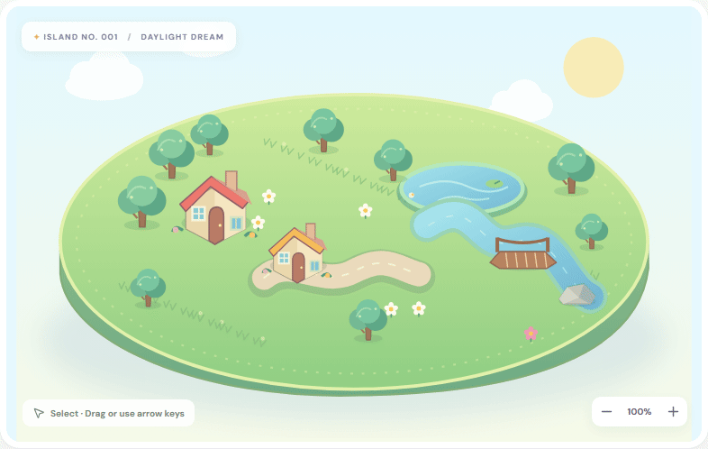
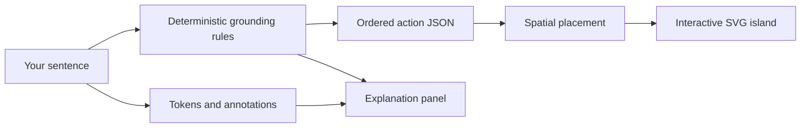

<div align="center">

# ✨ WordWorld
### Little words. Living worlds.

**Turn a sentence into a tiny world you can touch.**

[**▶ Enter the playground**](https://wordworld.vercel.app) · [Explore the API](https://wordworld.vercel.app/docs) · [Run it yourself](#run-it-yourself)

   

</div>

<a href="https://wordworld.vercel.app" title="Open the interactive WordWorld playground">

</a>

<p align="center"><em>A recording of the real app, powered by the Python parser. Click the island to try it.</em></p>

### Cast your first sentence

Each link loads the command into the live editor. Press **Generate** when you’re ready; your saved island stays yours.

| Try a little magic | What appears |
|---|---|
| [🏠 Build five houses: two blue and the remaining three red.](https://wordworld.vercel.app/?command=Build%20five%20houses%3A%20two%20blue%20and%20the%20remaining%20three%20red.) | Exactly five cottages, with two blue roofs and three red roofs |
| [🌳 Plant trees, a total of five: two green and the remaining three purple.](https://wordworld.vercel.app/?command=Plant%20trees%2C%20a%20total%20of%20five%3A%20two%20green%20and%20the%20remaining%20three%20purple.) | Five trees in two color groups |
| [🌉 Put a bridge spanning the creek.](https://wordworld.vercel.app/?command=Put%20a%20bridge%20spanning%20the%20creek.) | A bridge across the existing river |
| [🌙 Make it night with rain.](https://wordworld.vercel.app/?command=Make%20it%20night%20with%20rain.) | A rainy evening on your island |

<details>
<summary><strong>🧩 Open the recipe book</strong></summary>

Try these in the editor, one request at a time:

```text
Behind the lake, plant a pair of trees
Build houses, one blue and one green; put a rock between them
Add two flowers whose petals are purple and three yellow
Remove one tree and add two pink flowers
Stop the rain
Clear the world
```

**Objects:** houses, trees, lakes, rivers, roads, bridges, flowers, mountains, towers, castles and rocks. **Colors:** red, blue, green, yellow, pink, purple, orange and white. Aliases such as cottage, creek and pond work too.

Colon and comma partitions replace the default group. An explicit total must agree with the counted groups. A final `the rest`, `the remainder` or `the remaining ones` group can infer its count from that total. `three each of pink and white` creates three of each color. `turn off the rain` clears weather; common passive adverbs such as `recently` work in roof-color clauses. Quarter groups use exact whole-object arithmetic; `of each color: red and white` expands the stated count for both colors. Mapped part clauses also support `will have been painted`. Unclear or conflicting counts produce a notice. Size words describe groups but do not resize sprites.

</details>

### Your words, made visible

| Imagine | Inspect | Make it yours |
|---|---|---|
| Add, remove, place and color objects with short English commands | See phrase highlights, a dependency-arc diagram with plain-English word roles, and action JSON | Select, drag, recolor roofs, leaves and petals, duplicate and delete |
| Use counted groups, within-request pronouns, spatial relations and weather | Read notices when a request is ambiguous or unsupported | Undo/redo, zoom and pan, keyboard shortcuts, share links, JSON import/export and a dark theme |

On phones, the command editor sits above the island with a visible **Create** button, 16px input text and larger touch controls. Tablet and landscape alignment, draft preservation and help dialogs have responsive checks. See the [mobile before/after review](docs/MOBILE_QA.md).

The world autosaves in your browser. There is no account or cloud scene storage; **Share & save → Copy share link** puts the whole island in the URL, and opening one keeps your own island one undo away. Missing landmarks and crowded placement are explained in the UI; scenes hold up to 120 objects.

<details>
<summary><strong>🔎 Look inside the language engine</strong></summary>



**spaCy provides tokens, POS tags and dependency annotations. Explainable rules extract the actions.** WordWorld is an NLP course project with a fixed vocabulary, handcrafted vector sprites and heuristic placement; it does not train a new neural model or generate arbitrary 3D objects.

The live app includes the English spaCy model. `/api/health` reports `parser: "spacy"`; `/api/parse` returns `model: "spacy"`. Without the model, local token annotations are limited. An offline browser preview supports only simple commands; use the Python backend for the NLP demonstration.

Pronouns resolve within one request, with bindings to actual new objects. Cross-request context, arbitrary narratives, named/color-filtered landmarks and spatially filtered removals remain limited. See the [latest diagnostic report](evaluation/reports/quarter_fixes_report.md) for concrete failures and complete predictions.

</details>

### Measured, with the rough edges showing

Current verification and ten diagnostic scores are recorded in the [latest evaluation report](evaluation/reports/quarter_fixes_report.md). All historical gold labels and first-run predictions are preserved. Saved-set retests and a newly frozen 50-command sample are reported separately.

**532 Python tests · 23 scene tests · 62 desktop/mobile browser checks · production build passed.**

| Saved sets 1 → 9, retested | New sample 10, first run |
|---|---|
| 50/50 · 48/50 · 45/50 · 46/50 · 47/50 · 46/50 · 45/50 · 44/50 · 44/50 | **40/50 (80%)** — 40/40 core, 0/10 broader probes |

The latest fixes address quarters, “of each color,” mixed-type shared locations and future perfect part-color clauses. Fractions require an explicit total that gives whole objects. Shared comma tails apply to all sources in one creation clause and resolve before new objects enter reference state. Broader gaps include thirds, percentages, alternate each wording and cross-clause collections; the report shows every failure.

These are **implementation-aware, hand-authored diagnostic samples**, not independent human-labeled or random real-user accuracy estimates. The fresh set is frozen before its first prediction; no parser or gold tuning follows that run. Exact match compares every field of the ordered action dictionaries.

<details>
<summary><strong>🧪 Reproduce the checks</strong></summary>

From the project root, with both servers running for browser checks:

```powershell
.\.venv\Scripts\python.exe -m pytest -q tests
.\.venv\Scripts\python.exe -m tests.evaluate
cd frontend
npm test
npm run build
npx playwright install chromium
npm run test:e2e
```

The report includes exact dataset hashes, backend fingerprints and commands for all ten evaluations. Parser tests cover action semantics and source spans; scene tests cover placement and references; browser tests cover the API-to-canvas flow on desktop and mobile, editing, saved state, failures and safe README command links.

Set `WORDWORLD_BASE_URL` to a hosted URL to run the same browser suite remotely. To regenerate the preview with the local servers running: `cd frontend; node scripts/capture-readme.mjs`. Then use FFmpeg from the root:

```powershell
ffmpeg -y -framerate 1/2 -i .runtime/readme-frames/%02d.png -filter_complex "[0:v]split[a][b];[a]palettegen[p];[b][p]paletteuse" -loop 0 docs/assets/world-preview.gif
```

The [static preview](docs/assets/world-preview.png) is available if animation is inconvenient. Historical round reports live in [evaluation/](evaluation/).

</details>

### Run it yourself

Use Python 3.12 and Node.js 20 or later. In Windows PowerShell, open two terminals in the project folder.

**Terminal 1 · Python API**

```powershell
python -m venv .venv
.\.venv\Scripts\python.exe -m pip install -r backend/requirements-dev.txt
.\.venv\Scripts\python.exe -m uvicorn backend.main:app --reload --reload-dir backend --port 8000
```

**Terminal 2 · React app**

```powershell
cd frontend
npm ci
npm run dev
```

Open **http://localhost:5173**. Vite proxies `/api` to port 8000. The pinned backend requirements include the English spaCy model; the first install requires internet access.

<details>
<summary><strong>🛠 Architecture, deployment and project map</strong></summary>

| Path | Purpose |
|---|---|
| `backend/parser.py` | Clause splitting, grounding and original text spans |
| `backend/lexicon.py`, `backend/phrases.py` | Vocabulary patterns; quantity, relation and color readers |
| `backend/references.py` | Request-local references |
| `backend/main.py` | FastAPI health and parse routes |
| `frontend/src/App.jsx` | Scene state, history, commands and shortcuts |
| `frontend/src/components/` | Panels, dialogs, share menu and dependency arcs |
| `frontend/src/share.js`, `view.js`, `theme.js` | Share links, zoom/pan camera, light/dark theme |
| `frontend/src/Scene.jsx` | Original SVG sprites and interactive canvas |
| `frontend/src/world.js` | Actions, references and placement geometry |
| `tests/`, `evaluation/` | Regression tests, frozen labels; [evaluation index](evaluation/README.md) of reports and predictions |

Vercel hosts the **whole interactive app**, including FastAPI, using the root `vercel.json` Services configuration. `/api/*`, `/docs` and `/openapi.json` reach Python; other requests reach Vite’s build. The frontend needs no API secret. The repository remains private. CLI deployment is available; automatic Git deployments require the Vercel GitHub integration to have repository access.

Deploy committed source using `vercel deploy --prod --skip-domain`, test the deployment’s health, parser and UI, then `vercel promote <deployment-url>`. Protected URLs require authenticated access. Runtime packages and the spaCy model are pinned; local environments, logs and test artifacts are excluded from deployment.

The README uses an animated recording, native expandable sections and links into the live app. GitHub itself renders the document; the interactive playground runs on Vercel with its Python backend.

For earlier feature notes, setup background and evaluation history, see the [development archive](docs/DEVELOPMENT.md). That archive is a historical snapshot; this README and the latest report describe the current release. Third-party packages retain their own licenses.

</details>

<div align="center">

**A sentence is a small beginning. [Build somewhere new →](https://wordworld.vercel.app)**

</div>
