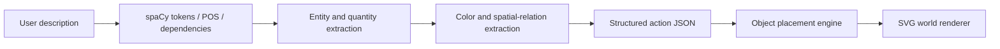

# ✨ WordWorld — Imagine it. Build it.

**WordWorld** is a course-project MVP that turns short English descriptions into a colorful, draggable world. The React interface displays a miniature island; a Python NLP service interprets the user's instructions and generates **structured world actions**.

> Example: "Build three red houses beside the lake" → `add(house, count=3, color=red, relation=near, target=lake)` → three cottages appear near the lake.

## What works

- Free-text commands to **add** houses, trees, lakes, rivers, roads, bridges, flowers, mountains, towers, castles, or rocks.
- Extract quantities, a limited set of colors, and directional/spatial relationships such as `beside`, `behind`, `left of`, `near`, and `across`.
- Ground `between two houses` and `between the house and the lake` using two distinct existing landmarks. A single new object goes at their midpoint; a group is spaced along the connecting segment.
- Process mixed add/remove instructions in order, keep quantities and colors scoped to their objects, and interpret `no rain` / `stop snowing` as clear weather. Simple negated and zero-count object instructions are skipped with an explanation.
- Recognize curly-apostrophe negation, preserve objects mentioned in keep/leave/protect clauses, and parse quantities such as eleven, a dozen, half a dozen, and two pairs. Negative, fractional, and ambiguous quantities are skipped with notices; each action adds at most 16 objects.
- Handle initial location phrases such as `Behind the lake, plant a pair of trees` and `Between the house and the tower, place a bridge` without creating the landmarks again. Original text offsets remain exact after matching Unicode punctuation.
- Interpret `spanning` and `crossing` as across, without creating their landmarks. Unsupported noun connections abstain with notices.
- Resolve `it` and `them` within one command: typed creation groups support bounded removal and singular/two-object spatial references. Bindings identify actual newly created scene objects, so older objects are preserved even when the scene limit blocks a creation. Reset clears references; time/weather settings retain them. References do not persist between API requests.
- Expand separately counted coordination such as `two red and three blue houses` or `two small and three large houses` into separate actions, including comma lists, mixed colored/uncolored groups, shared placement, and per-group negation. Numeric conjunctions stay intact. Small/large describe groups; they do not change sprite size.
- Attach adjacent post-noun colors (`with a blue roof`, `whose roof is green`, `that is pink`) to house roofs, tree leaves/foliage, or flower petals. Read appositive quantities such as `houses, three of them`, `five in total`, and `half a dozen altogether` before creation and reference resolution. Conflicting or ambiguous attributes abstain with notices. The explanation highlights their original text spans.
- Parse `exactly five` and `five in all`, roof clauses such as `roofs painted blue` / `a roof that is yellow`, adjacent noun ellipsis (`two houses and three large ones`), and counted relative continuations (`two trees that are green and three that are yellow`). Each group keeps its own count/color and participates in later `them` references. `ones` inherits the adjacent source noun type; a new verb or intervening placement ends that scope. Omitted colors use the existing default.
- Counted comma partitions replace the implicit noun default: `trees, two green and three yellow` adds exactly five trees. Declared totals must match relative/part/color groups. Support `has/have/had been painted` part-color clauses, `five total`, and omitted color predicates (`two trees that are green and three yellow`). Conflicting partition totals/colors abstain with notices.
- `remove houses`, `clear the world`, `make it night`, `make it rain`, and `make it snow`.
- Illustrated 2.5D-style SVG world; click to select, drag to reposition, duplicate, delete, change house roof colors, zoom.
- Undo / redo, starter village, JSON export, autosaving to localStorage.
- NLP analysis panel showing the tokens, POS/dependency annotations (with the spaCy model installed), and the structured actions.
- Inline phrase highlights, selectable tokens with lemma/dependency heads and exact character spans, parser notices, and expandable action JSON. Selected grounded objects show placement guides; manually moving an object clears its original placement guide.
- Keyboard selection with Enter/Space and movement with arrow keys (Shift for larger steps); reduced-motion support. House roofs, tree foliage, and flower petals reflect their requested colors.
- Limited browser-only command parser enables UI preview if the Python backend is offline. **Use the Python backend for the actual NLP demonstration.**

## Tech stack

| Component | Technology |
|---|---|
| Frontend | React 18, Vite, plain CSS, SVG scenes, lucide-react |
| Backend | Python 3.10+, FastAPI, spaCy |
| Parsing | spaCy POS/dependency annotation + explainable lexical/semantic grounding rules |
| State | React state, browser localStorage |
| Tests | pytest (parser), smoke test for API and scene actions |

## Run locally (Windows PowerShell)

Open a terminal in the `wordworld` folder.

**Terminal 1 — NLP API:**

```powershell
python -m venv .venv
.\.venv\Scripts\Activate.ps1
pip install -r backend/requirements-dev.txt
python -m spacy download en_core_web_sm
python -m uvicorn backend.main:app --reload --reload-dir backend --port 8000
```

If PowerShell blocks activation, run `.venv\Scripts\python.exe -m pip install -r backend/requirements-dev.txt`, followed by `.venv\Scripts\python.exe -m spacy download en_core_web_sm`, and `.venv\Scripts\python.exe -m uvicorn backend.main:app --reload --reload-dir backend --port 8000` without activating the environment. Watching only `backend/` avoids reloads triggered by tests, reports and parser backups. `requirements.txt` contains runtime packages; `requirements-dev.txt` adds pytest and the HTTP client used by API tests.

**Terminal 2 — React website:**

```powershell
cd frontend
npm install
npm run dev
```

Open **http://localhost:5173** in the browser. The UI proxies `/api` requests to `http://127.0.0.1:8000` automatically. The interactive API docs are available at **http://localhost:8000/docs**.

The React project needs `npm install` to download its packages. An internet connection is required for first-time installation and the optional Google Fonts.

### Run in Codex

1. Unzip/open the **`wordworld`** folder as your Codex project/workspace (or commit the folder to a GitHub repository and open that repository in Codex).
2. Ask Codex: **"Read AGENTS.md and README.md. Set up WordWorld, run the parser tests, run the frontend build, then launch the Python API and Vite development server. Fix any errors found."**
3. Both terminals must stay running while you interact with the website.

## Sample commands

```
Build a small village next to the lake
Plant five trees behind the houses
Add two pink flowers near the castle
Build a bridge across the river
Put a bridge between two houses
Remove one tree and add two pink flowers
Stop the rain
Add a tower to the left of the houses
Make it night with rain
Remove all the flowers
Clear the world
```

## NLP pipeline



### API example

**POST `/api/parse`**

Request:

```json
{"text":"Place three trees beside the lake"}
```

Response (shortened):

```json
{
  "actions": [
    {"action":"add", "type":"tree", "count":3, "color":null, "relation":"near", "target":"lake"}
  ],
  "model":"spacy",
  "tokens":["..."],
  "message":"Understood 1 instruction."
}
```

The `model` field will be `spacy-tokenizer` if spaCy is installed **without** `en_core_web_sm`, or `rules` if spaCy itself is not available. Dependency and POS tags require the English model. The action extraction is rule-based even when spaCy annotations are enabled. The project **does not** train a new neural language model.

## Test and evaluate

From the root project directory:

```bash
python -m pip install -r backend/requirements-dev.txt
python -m pytest -q tests
python -m tests.evaluate
```

From `frontend/`:

```bash
npm run build
npm test
npx playwright install chromium
npm run test:e2e
```

Keep the backend on port 8000 and Vite on port 5173 while running `npm run test:e2e`. These Playwright checks cover desktop and mobile layouts, API-backed commands, midpoint geometry, drag/keyboard manipulation, recoloring, undo/redo, autosave, weather, API validation errors, and offline preview behavior. `npm test` checks placement geometry and preview behavior without a browser. Frontend tests require Node.js 20 or later.

The evaluation script compares full action JSON (including colors, settings, and both targets) against 50 hand-written **development regression commands** in `tests/commands.json`. It reports per-command intent, entity/count/color/settings, spatial, and exact-match scores and exits with a failure if any command differs. Spatial accuracy is calculated over commands containing a gold spatial relation. Save metrics and errors with `python -m tests.evaluate --json evaluation.json`; compare an older parser using `--parser-file path/to/parser.py`.

This development set was used while fixing the parser; its score is not evidence of unseen-language accuracy. For a course report, label a separate, independent set of at least 50 unseen commands and report **intent accuracy, entity/count accuracy, spatial relation accuracy, and end-to-end exact-match accuracy**. Include error cases, not only successful demos. See `TEST_RESULTS.md` for the current local verification results.

The first separate diagnostic set is now used for regressions. Its exact-match score improved from 35/50 to 46/50 after priority fixes. A second 50-command set was labeled and frozen before its first execution on the updated parser: 40/50 exact matches, with 40/40 core commands and 0/10 broader capability probes. These are hand-authored diagnostic samples, not random real-user accuracy estimates. See `evaluation/reports/priority_fixes_report.md` for all commands, predictions, remaining errors and reproduction commands. Original labels/results are preserved; development retests require `--allow-parser-change` and a separate output path.

After the reference/coordination fixes, those same two sets retested at 50/50 and 46/50. A third fresh 50-command set, frozen before predictions and checked against prior inputs, scored 41/50 (40/40 core cases and 1/10 broader probes). See `evaluation/reports/reference_fixes_report.md` for that round's results, all commands, exact errors and reproduction commands. The fresh evaluator fingerprints all backend Python sources, including the reference module. Retests and fresh samples remain separate; no historical gold labels or baseline outputs are overwritten.

After the post-noun/coordination fixes, all three saved diagnostic sets retested at **50/50, 47/50, and 45/50**. A fourth newly labeled 50-command set, frozen before its first predictions, scored **40/50 (80%)**, with 40/40 core cases and 0/10 broader probes. See `evaluation/reports/postnoun_fixes_report.md` for that round's results. Verification then: 223 Python tests, 16 scene tests, 18 desktop/mobile browser tests, and the production build passed. No rules or labels were tuned during fourth-set evaluation.

After the quantity/roof/ellipsis fixes, the four saved sets retested at **50/50, 47/50, 45/50, and 46/50**. The fifth fresh 50 scored **41/50 (82%)**, with 40/40 core cases and 1/10 broader probes. See `evaluation/reports/ellipsis_fixes_report.md` for that round's results. Verification then: 280 Python tests, 16 scene tests, 20 desktop/mobile browser tests, and the production build passed.

After the counted-partition/passive/predicate fixes, all five saved sets retest at **50/50, 47/50, 45/50, 46/50, and 46/50**. The sixth fresh 50 scores **41/50 (82%)**, with 40/40 core cases and 1/10 broader probes. All five targeted fifth-set failures pass. Frozen gold and backend hashes precede first prediction; no subsequent rule/label tuning occurred. These implementation-aware hand-authored diagnostic samples are not independent human-labeled or random real-user benchmarks. See `evaluation/reports/partition_fixes_report.md` for the latest results, all 50 commands, exact errors and reproduction commands. Verification: **322 Python tests, 16 scene tests, 22 desktop/mobile browser tests, and the production build pass**.

## Deploy to Vercel

The root `vercel.json` deploys the Vite frontend and Python FastAPI backend together using Vercel Services (currently beta). `/api/*`, `/docs`, and `/openapi.json` reach the backend; other paths reach the frontend. Browser requests use the same-origin API, so no production API URL or browser secret is required.

The backend uses Python 3.12 with runtime/model versions pinned in `backend/requirements.txt` and `pyproject.toml`. Vercel installs the requirements nearest its resolved Python entrypoint. The spaCy English model is installed at build time. Virtual environments, node_modules, runtime logs, local environment files and browser artifacts are excluded from uploads. The Python function excludes frontend/test/evaluation files from its bundle.

After linking the intended Vercel project, deploy the committed source with `vercel deploy --prod --skip-domain`, verify `/api/health`, `/api/parse`, and the UI on that deployment, then promote the tested URL with `vercel promote <deployment-url>`. Local development commands remain unchanged.

To run browser checks against a hosted URL, set `WORDWORLD_BASE_URL` to that URL before `npm run test:e2e`. Protected deployment URLs require authenticated access; the production domain can be tested directly. The repository remains private; Git-based automatic deployments also require the Vercel GitHub integration to have access to that repository.

## Architectural notes and limitations

- This is an **interpretable MVP**, **not** a general text-to-3D generative model. Object sprites are pre-drawn vector art. The text maps onto a fixed scene vocabulary.
- Distances are heuristic; `near`, `left`, `right`, etc. use geometry relative to an existing object. Landmarks are selected by type and recency, not by color or name. `between` uses the latest two distinct objects of the requested types. Missing landmarks or an impossible on-island direction produce fallback placement and a notice.
- Placement searches for less crowded spots while preserving a direction. Dense scenes and intentional overlaps (`across`, `inside`, and `between`) can still overlap. The scene limit is 120 objects; additions do not evict existing objects.
- The model handles **short, direct English instructions** best. Arbitrary negation, long narratives, cross-request pronouns and multi-hop reference resolution remain outside this MVP. Within one command, singular `it` needs a live singular introduction; `them` needs a plural collection. Partial selection from mixed types and plural spatial references other than two-object `between` abstain. Chained landmarks trigger a notice and only the first spatial relation is used. Spatially filtered removal is rejected with a notice rather than deleting every object of that type.
- Offline preview accepts one simple add or time/weather instruction. It leaves spatial, mixed, and removal commands unchanged and asks for the Python API. API validation errors are displayed and do not activate preview parsing.
- `Put a bridge spanning the creek` creates only a bridge grounded across the river. Unsupported relations such as `that crosses the river` abstain instead of creating extra objects. Counted comma partitions no longer create a default object first. The sixth sample still fails colon partitions, `a total of five`, `the remaining three`, `has already been painted`, comma-separated `all near...`, latter/cross-clause references, group multiplication and broader subordinate/setting paraphrases. Some failures silently apply partial/wrong actions; the latest report lists predictions and notices.
- The scene is local-only. JSON can be exported and used for additional features later; no cloud sharing or authentication is implemented.
- Open external package/library dependencies under their respective licenses; the world art is generated from SVG markup in `frontend/src/Scene.jsx`.

## Suggested improvements for Codex

- Extend grounded references to cross-request conversational context and supported uses of `there`, with explicit ambiguity handling.
- Add a fully independent labeled evaluation set and confusion/error visualization.
- Improve dense-scene collision handling, named/color-filtered landmark resolution, and spatially filtered removal.
- Allow importing an exported JSON scene.
- Add agentic generated stories or quests as a separate optional mode (not needed for the MVP).
