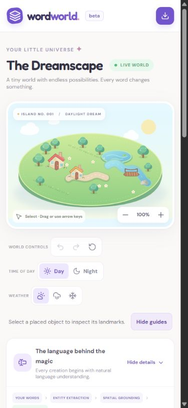
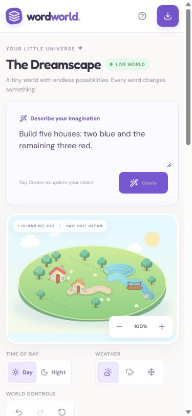
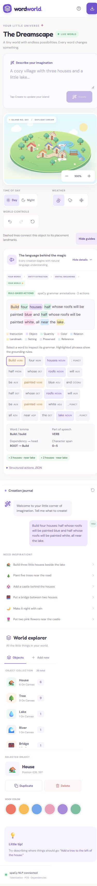
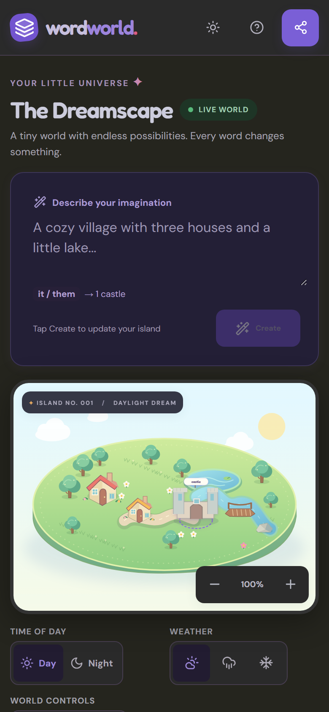

# Mobile experience check — 15 October 2026

The command editor is now reachable before the island on phones, and the main controls have larger touch targets. A tablet canvas overflow is fixed. The existing palette, sprites and desktop layout are retained.

## Captured flow

1. **Open the original phone layout — friction found.** At a configured 390x844 viewport, the editor began around y=1299, below the island, controls and analysis. Most world controls measured 32–33px tall. The top export icon lacked an accessible name after its text was hidden; help was hidden entirely.

   

2. **Open the updated layout — improved.** With the same starter village and command draft at the same configured viewport, the editor begins around y=205, before the island. Create has a visible text label. World and zoom controls measure at least 44x44px. The input uses 16px text, mobile Enter inserts a newline, and help/export have accessible labels. Document scroll width equals viewport width.

   

3. **Create and inspect — working.** The phone submits `Build four houses: half whose roofs will be painted blue and half whose roofs will be painted white, all near the lake.` The full Python API returns two blue and two white houses near the lake, increasing the scene from 22 to 26 objects. The screenshot shows the placement guide, exact phrase highlights, action chips, journal and selection controls. Undo restores the prior state. The pre-audit local scene was restored afterward.

   

   
Open the complete mobile result and explanation

   

   

## Checks and fixes

| Check | Evidence/result |
|---|---|
| Primary editor placement | Above canvas on phones and narrow landscape; one live editor |
| Primary touch targets | World, zoom and Create controls at least 44x44px |
| Horizontal alignment | No document overflow at 320, 390, 430, 768 and 844px test widths |
| Tablet canvas | Explicit width prevents aspect ratio/minimum height from widening the column |
| Phone landscape | Compact layout at widths up to 950px when height is at most 500px |
| Long/short dialogs | Help stays within viewport width and scrolls within viewport height |
| Resize continuity | Draft and saved objects survive desktop/phone switching |
| Input behavior | Mobile Enter adds a newline; desktop Enter submits; button works in both |
| Output | Long command highlights and journal remain within document width |
| Existing actions | Dragging, keyboard movement, recolor, undo/redo, duplication, deletion and autosave pass |

The in-app browser supplied the screenshots and DOM measurements in this audit. The automated Chromium suite separately checks 320x740, 390x844, 430x932, 768x1024 and 844x390 in desktop and mobile contexts, plus breakpoint switching. All 42 browser checks pass locally. Production verification uses the same suite after deployment.

## Dark theme and new controls — 16 October 2026

The dark theme, share menu, theme toggle, size buttons and composer reference chip were checked at a configured 390x844 phone viewport in Chromium, with the full Python parser.

- **Touch targets (measured):** theme toggle, share menu and help 44x44px; zoom 44x44px; size buttons 44x44px; Create 100x44px.
- **Fixed during this check:** on narrow screens the island SVG is letterboxed, and the frame behind it showed the dark app background as bands above and below the sky. The scene now paints the same sky gradient behind itself, in either theme and at night.
- **References:** after “Build a castle”, the composer shows `it / them → 1 castle`, so a follow-up such as “make it bigger” is predictable.
- **Gestures:** two-finger pinch zooms around the pinch midpoint and cancels any object drag; an automated check dispatches touch pointers.

The same limits apply: viewport checks, not physical devices; contrast was reviewed visually, not measured against WCAG ratios.

## Limits

These are browser viewport checks, not physical iPhone/Android tests. Real on-screen keyboard occlusion, safe-area behavior, screen-reader navigation, color contrast and reduced-motion preferences were not comprehensively audited. Existing reduced-motion styles and keyboard interactions remain in place; the report does not claim full accessibility compliance. Very dense scenes and crowded placement remain separate limitations.
