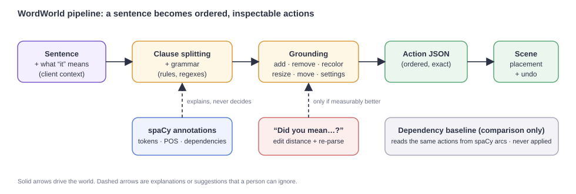
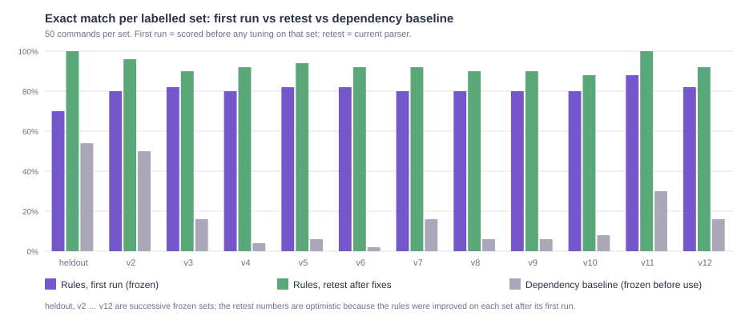
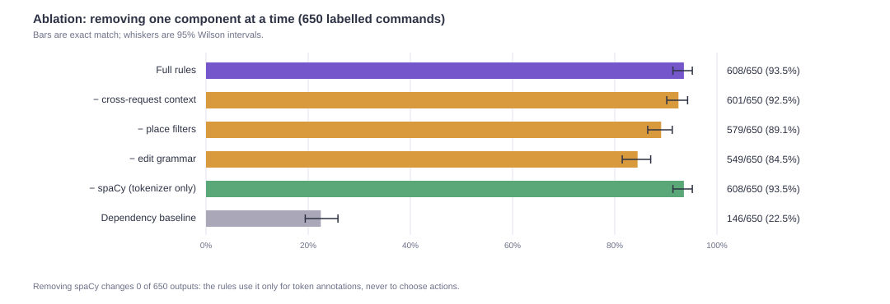
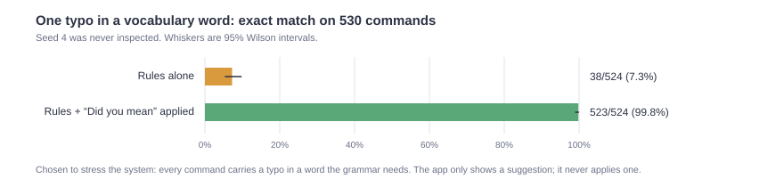

# WordWorld: grounding English sentences in a small world you can touch

*An explainable, rule-based language-to-action system, evaluated with frozen test sets, an ablation, a dependency-parse baseline, typo robustness and fuzzing.*

## 1. Summary

WordWorld turns short English commands ("Build five houses: two blue and the remaining three red", "paint the trees near the lake red") into an ordered
list of **actions** (add, remove, recolor, resize, move, set weather or time) that change an illustrated island. The language engine is a deterministic
rule grammar. spaCy supplies tokens, parts of speech and dependency arcs for the explanation panel, and **never chooses an action**.

What the evidence shows, in the order I would want to be told it:

- **The grammar is strong where it was built and narrow beyond it.** On sentences the author expected the grammar to handle (core cases), the
  first run on a frozen set scored **474/484 (97.9%)**. On sentences deliberately written outside the grammar (probes), it scored **9/116 (7.8%)**.
  The first number says the implemented features work; the second says unseen phrasings mostly do not. Real users will land closer to the second.
- **The rules, not the parse tree, carry the system.** A baseline that reads the same actions from spaCy's dependency arcs scores **22.5%** on all 650
  labelled commands against **93.5%** for the rules (the rules' score is optimistic, see §3). Removing spaCy from the rules changes **0 of 650** outputs.
- **A single typo is catastrophic without help, and recoverable with it.** With one typo in a vocabulary word, exact match falls to **7.3%**; applying
  the "Did you mean…?" suggestion restores **99.8%** (485 of the 486 commands that needed help), with 0 wrong fixes and 0 suggestions on 541 already-correct commands.
- **Fuzzing found real bugs that no hand-written test had.** Among them: numbers with thousands separators were split into two quantities, a
  1,200-character input took 4.7 seconds to parse, and an invalid Unicode character crashed the API.

Everything here is **implementation-aware**: the author wrote both the grammar and the gold labels. No result estimates accuracy on strangers' sentences.
A user-test kit (§7) exists to measure that, and has not yet been used.



## 2. The system

**Task and vocabulary.** Eleven object types (house, tree, lake, river, bridge, road, flower, mountain, tower, castle, rock) with aliases (cottage, creek, pond…),
eight colors, and the relations near, left of, right of, behind, in front of, inside, between and across. Every parsed meaning must be connected to a visible
change in the scene; a type or relation the scene cannot show is refused with a notice rather than guessed.

**Grammar.** Clauses are split on explicit separators, then each clause is read by regular-expression readers for quantities (including word numbers,
dozens, pairs, thousands separators), colors (before the noun, after it, or in a "whose roofs are…" clause), spatial phrases with one or two landmarks, counted
partitions ("two blue and the remaining three red"), fractions and percentages of a declared total, and negation or protection ("keep the houses").
Edits of existing objects (recolor, resize, move) and place filters ("the trees near the lake") are read by a separate module. Quantities are exact
arithmetic: a partition that does not sum to its total, or a fraction that is not a whole number of objects, is refused with an explanation.

**References.** "It" and "them" resolve inside a request against the objects just introduced. Across requests, the browser sends only what the last command
or click touched (object types and counts); the server keeps no state.

**Scene.** Placement follows the stated relation with a deterministic search that avoids overlap and stays on the island. Edits act on the most recent
matching objects. Every change goes through an undo stack.

**Explanation.** The interface shows the sentence with each grounding role highlighted, the spaCy dependency arcs with plain-English word roles, the action list, and
every notice the parser raised. A word's grammatical role and its grounding role are shown together, so a reader can see where the two agree.

**Typo suggestions.** For each unfamiliar word, the nearest vocabulary words (edit distance, counting an adjacent swap as one edit) are tried in turn; a correction is kept only if
re-parsing is *measurably better* (fewer notices, or more of the sentence understood), and the final sentence must produce actions. The vocabulary is read from the grammar's
own regular expressions, so a word the parser understands can never be mistaken for a typo. The correction is shown, never applied. Two details matter for safety. Notices that report a *deliberate* skip ("Skipped a negated instruction") are not counted as confusion, and a misspelled **negation word** is restored whenever that changes what will be done, because a typo like `nefer remove them` otherwise makes the command do the opposite of what was said.

## 3. How the evaluation works, and why its numbers must be read carefully

- **Frozen sets.** Each frozen set of 50 commands and its expected actions were written and hashed *before* the parser ever ran on them, together with a fingerprint of the backend
  source. The first run is stored untouched. After seeing the failures, the author improved the grammar; the same set is then scored again as a **retest**.
  The retest is not an accuracy estimate (the rules were tuned on it); the first run is the honest number.
- **Core and probe cases.** In every set, 40 commands are *core* (written to be within the grammar the author intended) and 10 are *probes* (natural English the author
  expected to be outside it). Core results measure whether the implemented features work. Only probes measure generalisation.
- **Thirteen sets, 650 commands:** a 50-command development set (hand-written, **not** frozen), a held-out set (50, with 44 core and 6 probe cases), and eleven further sets (v2 to v12). The twelve frozen sets contribute the 600 first-run results.
- **A baseline that never saw them.** The dependency-arc extractor was written against separate example sentences and frozen, by file hash, before its first run on any labelled set.
- **Intervals.** Counts carry 95% Wilson score intervals, which behave sensibly at these sample sizes.
- **Exact match** compares every field of the ordered action list. One field wrong is a failure.

## 4. Results

### 4.1 First run: strong in scope, narrow beyond it

| Set | First-run exact match | Core | Probes |
|---|---|---|---|
| heldout | 35/50 | 35/44 | 0/6 |
| v2 | 40/50 | 40/40 | 0/10 |
| v3 | 41/50 | 40/40 | 1/10 |
| v4 | 40/50 | 40/40 | 0/10 |
| v5 | 41/50 | 40/40 | 1/10 |
| v6 | 41/50 | 40/40 | 1/10 |
| v7 | 40/50 | 40/40 | 0/10 |
| v8 | 40/50 | 40/40 | 0/10 |
| v9 | 40/50 | 40/40 | 0/10 |
| v10 | 40/50 | 40/40 | 0/10 |
| v11 | 44/50 | 40/40 | 4/10 |
| v12 | 41/50 | 39/40 | 2/10 |
| **All** | **483/600 (80.5%; 95% CI 77.1–83.5%)** | **474/484 (97.9%; 96.2–98.9%)** | **9/116 (7.8%; 4.1–14.1%)** |

The held-out set was the first contact with unseen sentences: 35 of its 44 core commands, **79.5%**. Later sets score about 100% on core cases because each was written to
exercise features already built; that is a property of how the cases were chosen, not a trend toward general competence. The probe column is the one to quote when asked how well
the system understands English it was not designed for.



### 4.2 Ablation: what each component contributes

| Configuration | Exact match (650) | 95% interval |
|---|---|---|
| Full rules | 608 (93.5%) | 91.4–95.2% |
| − cross-request context | 601 (92.5%) | 90.2–94.2% |
| − place filters | 579 (89.1%) | 86.5–91.2% |
| − edit grammar | 549 (84.5%) | 81.5–87.0% |
| − spaCy (tokenizer only) | 608 (93.5%) | 91.4–95.2% |
| Dependency baseline | 146 (22.5%) | 19.4–25.8% |

Each removal costs exactly the commands that depend on the component. Removing spaCy changes no output at all (0 differing actions, bindings or notices across 650
commands), which verifies the project's central claim that spaCy annotates and the rules decide.



### 4.3 Where the baseline and the rules differ, by linguistic family

| Family | Commands | Rules | Baseline |
|---|---|---|---|
| counted partitions and fractions | 147 | 87.8% | 8.8% |
| references and pronouns | 86 | 93.0% | 5.8% |
| edits and place filters | 74 | 100.0% | 29.7% |
| spatial relations | 68 | 98.5% | 20.6% |
| colors and attributes | 68 | 98.5% | 0.0% |
| negation, protection, removal | 42 | 97.6% | 57.1% |
| weather and time | 30 | 93.3% | 36.7% |
| quantities | 30 | 100.0% | 36.7% |
| coordination and multi-action sentences | 28 | 100.0% | 14.3% |
| clause structure | 16 | **43.8%** | 0.0% |
| paraphrase and lexical variation | 11 | **63.6%** | 27.3% |
| development set (uncategorised) | 50 | 100.0% | 78.0% |

Dependency arcs locate verbs, objects and prepositional phrases well, which is why the baseline is competitive on the short, canonical development set (78%). They do not say how a total splits into colored groups,
which mention a pronoun refers to, or that an object after "keep" is protected, so the baseline collapses on those families. Families are assigned from category names and are approximate.

### 4.4 Typo robustness

Every labelled command the rules already get right was given one synthetic typo (a deletion, duplicated letter, adjacent swap or QWERTY-neighbour substitution) in a vocabulary word of at least four letters, generated
from a fixed seed. The suggester was developed on seed 1. Seed 2 was viewed while the report was drafted, which exposed a real tie-break bias (a longer plural won because it highlights more text), fixed on principle. Seed 3 was then the untouched seed, and its two failures were both
**typos in negation words**: `nefer remove them` *removed* what the person had forbidden, because the score treated the correct "Skipped a negated instruction" notice as a sign of confusion. Deliberate-skip notices no longer count against a correction, and
restoring a negation word counts as progress whenever it changes what will be done. Seeds 2 and 3 are therefore reported as *reviewed*, and the headline uses **seed 4, which nobody inspected**.

| | Exact match (524 commands, seed 4) | 95% interval |
|---|---|---|
| Rules alone | 38 (7.3%) | 5.3–9.8% |
| Rules + the suggestion applied | 523 (99.8%) | 98.9–100.0% |

Of the 486 commands the typo broke, 485 were recovered, 0 received a wrong fix and 1 was missed (a silent change of meaning with no suggestion; seed 4's cases were deliberately not inspected). The suggester made **no** suggestion on any of the 541 labelled commands the rules already parse correctly. The
7.3% is conditional on a typo landing in a word the grammar needs, chosen to stress the system; it is not a prediction of how often people mistype.



### 4.5 Robustness testing

Random and adversarial inputs were fed to each layer. The findings, each now guarded by a regression test:

| Layer | Finding | Fix |
|---|---|---|
| Parser | `Plant 12,345 trees` built two groups (12 and 16); the comma split the number | numbers with thousands separators are one number; capped at 16 with a notice |
| Parser | A 1,200-character list took about 4.7 s (cost grew with roughly the cube of the group count) | commands above 40 list separators are refused; the slowest adversarial case dropped to 0.11 s |
| Parser | A zero-count edit was not skipped | skipped with a notice, like creation and removal |
| HTTP API | A lone UTF-16 surrogate in a JSON body returned a bare-text 500, and the app misreported it as "API offline" | validation errors no longer echo the input; unexpected failures return JSON the app shows |
| Scene | Invalid settings were accepted; guides kept pointing at removed landmarks; objects "inside" a landmark could leave the canvas | settings validated; guides pruned; placement clamped |
| Frontend | Imported or shared objects could sit outside the draggable area | clamped to the island bounds |

The exploratory fuzzing used roughly 6,000 random parser inputs, 2,100 timed adversarial inputs, 10,000 random scene steps and a few dozen malformed HTTP bodies. The scripts were exploratory and are not all in the repository; the
findings are guarded by committed tests, including a seeded property test of the scene invariants.

### 4.6 Accessibility and operations

- **Accessibility.** axe-core (WCAG 2.0 to 2.2 A and AA, plus best practices) over nine states, two themes and two device sizes measured **866 failing checks** in its first run (eight states; the permanent test covers nine). **792** were color-contrast failures, counted once per page state, which are **94 distinct elements** using 52 foreground/background pairs: 744 in the light theme and 48 in the dark. The other **74** came from three structural rules: 32 buttons whose accessible name omitted their visible text, 32 pages with two identically unnamed sidebars, and 10 phone-sized pages with no heading. The fix changed **35 color tokens** (33 light, 2 dark), removed `opacity` from text whose blended color could not be a token, and corrected the markup; the suite now reports **0 violations** and runs in CI. The first, blunter fix (darkening every muted color) was rejected because it flattened the visual hierarchy; the shipped fix changes only the colors axe measured as failing.
- **Latency.** On the deployed site the first request after idle took **6.4 s** (a cold start loading spaCy); later requests took **340 to 410 ms**. The interface now says the language engine may be waking up after 4 seconds.
- **Abuse protection.** `POST /api/parse` has a best-effort per-client rate limit (300 per minute by default). On serverless hosting each instance counts separately, so this protects against one client hammering one instance, not against a determined flood; hard limits belong in the host's firewall rules.

## 5. Error analysis

- **The narrow edge.** 9 of 116 probes pass first time. The misses are mostly paraphrase and structure: a count given after a color list ("in each of pink and white, two per color"), a trailing each-count ("four of each"),
  group multiplication ("two clusters of three"), and relative or subordinate clauses. Clause structure (44%) and paraphrase (64%) are the weakest families in the retest as well.
- **Three tracked gaps.** The three wordings above are kept as strict expected failures in the tests, so they stay visible and an accidental fix is noticed.
- **Unsupported on purpose.** "Between" and "across" place filters and pronoun landmarks ("the trees near it") are refused with a notice; the scene has no way to test them yet.
- **A labelling error, kept.** One round-twelve core label asked for 18 flowers while the documented cap is 16 objects per action. The parser followed the documented behaviour; the gold was wrong. Frozen labels are never
  edited, so it stays a miss in every number, and the report says why.
- **Silent wrong results are the worst failure.** Before fixing, two sentences in round twelve produced objects without the stated colors and no warning, and typos in negation words made the parser perform a forbidden removal. A notice now appears whenever a
  typed color is used by no action, and a misspelled negation word is corrected whenever that changes what will be done.

## 6. Threats to validity

1. **The author wrote the grammar and the gold labels.** Every set was frozen before its first prediction, but the author knew earlier errors and wrote later sets to test newly built features.
2. **Retests are optimistic**, because the rules were improved on each set after its first run. The first-run numbers are the ones to trust.
3. **Probes are few** (116 in total) and were chosen by the author, so the 7.8% has a wide interval (4.1–14.1%) and reflects the author's idea of what is out of scope.
4. **Synthetic typos are not human typing.** Phonetic spellings, missing spaces and autocorrect substitutions are not modelled.
5. **The baseline is one simple design.** A dependency-arc extractor is a deliberately minimal alternative; it is not evidence about neural or large-language-model parsers, which were not tested.
6. **Family labels are heuristic**, assigned from category names.
7. **No human participants yet.** Nothing here measures performance on strangers' sentences.

## 7. Next steps

1. **Run the user-test kit** (`docs/USER_TESTING.md`) with 5 to 10 people, analyse the downloaded logs, freeze the real failures as a new set and report its first run separately.
2. **Add a neural or large-language-model baseline** scored on the same frozen sets, to answer whether the rules' advantage survives a stronger comparison.
3. **Close the tracked gaps and the between/across filters**, after the sessions show which matter.
4. **Measure the typo suggester on human errors** collected by the test kit rather than synthetic ones.

## 8. Reproducing the numbers

```powershell
.\.venv\Scripts\python.exe -m pytest -q tests          # 806 tests (3 tracked expected failures)
.\.venv\Scripts\python.exe -m tests.evaluate           # development set
.\.venv\Scripts\python.exe -m tests.ablation           # §4.2-4.3  (evaluation/reports/ablation_report.md)
.\.venv\Scripts\python.exe -m tests.evaluate_typos     # §4.4     (evaluation/reports/typo_robustness_report.md)
.\.venv\Scripts\python.exe -m tests.compare_extractors --check
.\.venv\Scripts\python.exe -m tests.make_figures       # redraws the figures from the recorded results
```

First-run results for each frozen set are in `evaluation/results/`; the sets and the scripts that froze them are in `tests/`.

## References

- Winograd, T. (1972). *Understanding Natural Language.* Academic Press. (SHRDLU, the classic language-to-blocks-world system.)
- Wilson, E. B. (1927). Probable inference, the law of succession, and statistical inference. *Journal of the American Statistical Association*, 22(158), 209–212.
- Damerau, F. J. (1964). A technique for computer detection and correction of spelling errors. *Communications of the ACM*, 7(3), 171–176.
- Levenshtein, V. I. (1966). Binary codes capable of correcting deletions, insertions and reversals. *Soviet Physics Doklady*, 10(8), 707–710.
- Honnibal, M., Montani, I., Van Landeghem, S., Boyd, A. (2020). *spaCy: Industrial-strength Natural Language Processing in Python.* Zenodo.
